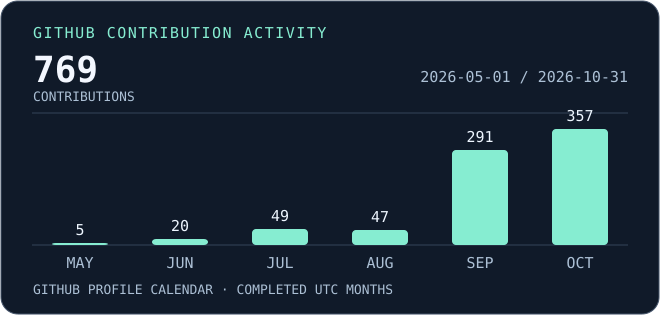

# Arnav Kulshreshtha

**Software engineer · Independent product builder · Mathematics & computing**

I build native macOS software and full-stack products. I’m drawn to the parts of a product where the implementation shapes what people experience, from how a display responds to sudden changes to how numerical code handles values at the limits of an integer type.

[Phosphor](https://usephosphor.app) · [LinkedIn](https://in.linkedin.com/in/arnav-kulshreshtha) · [Open-source work](#open-source)

## Featured work

### Phosphor · Native macOS display utility

Phosphor helps Mac users manage their displays. Flashbang Protection addresses abrupt changes in brightness, and Studio Features provide display tools for calls and presentations. The app supports macOS 13 and later.

[Explore Phosphor](https://usephosphor.app)

### LPython · Numerical correctness in the runtime

I submitted changes for intermediate integer overflow in combinations, permutations, least common multiples, and hypotenuse calculations. The work focuses on cases where a result can be representable even though an intermediate operation overflows.

## Engineering focus

| Area | Tools and work |
| --- | --- |
| **Native desktop** | Swift, SwiftUI, Xcode, and Metal for macOS interfaces and graphics |
| **Systems and algorithms** | C++, Objective-C++, platform APIs, integer edge cases, and event-driven software |
| **Full stack** | TypeScript, JavaScript, React, Next.js, PostgreSQL, and SQL migrations |
| **Tooling and computation** | Python, automated testing, CI, and mathematical computing |

## Development activity

The chart uses GitHub’s contribution calendar and includes anonymized private activity when shared through the profile. GitHub applies its own contribution rules. The chart covers completed UTC months, and its date range appears in the graphic.

[Machine-readable snapshot](data/activity.json) · [Collection and privacy policy](ANALYTICS.md)

## Experience

**Software Engineering Intern · MeghGen Technologies**

May–July 2026

Worked on developer tooling and software development automation, including agent skills and cross-language test generation. The public shared tooling repository records my contributions.

[Shared developer tooling](https://github.com/sanskarkhatri-meghgen/skills)

## Education

**BITS Pilani, K. K. Birla Goa Campus**

B.E. (Hons.) in Mathematics and Computing · 2024–2028 (expected)

My interests include algorithms, numerical computation, and the systems that put them to work.

## Open source

- **LPython · Permutations and combinations.** [Integer overflow patch](https://github.com/lcompilers/lpython/pull/2879)
- **LPython · Least common multiple and hypotenuse.** [Revised overflow patch](https://github.com/lcompilers/lpython/pull/2881)
- **LPython · Documentation.** [Documentation improvements](https://github.com/lcompilers/lpython/pull/2878)

The links point to submitted upstream work. GitHub shows the current review and merge status.
