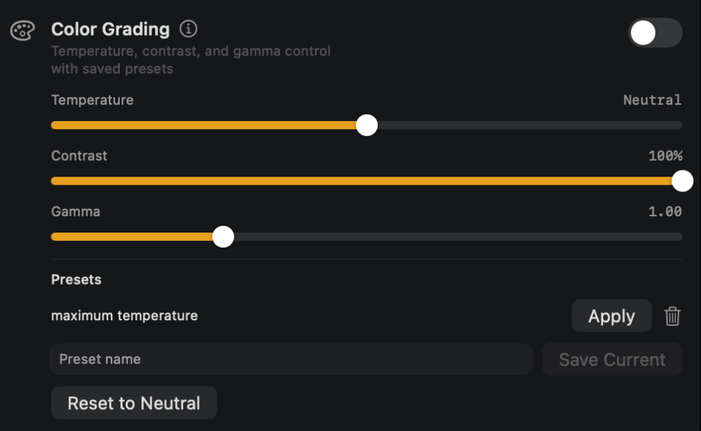
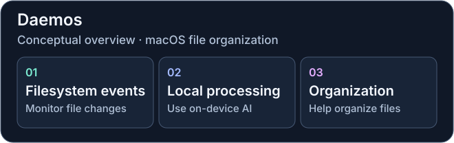
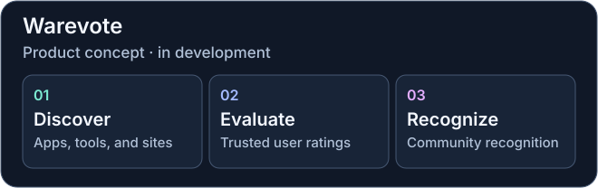
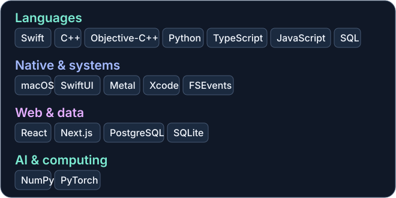
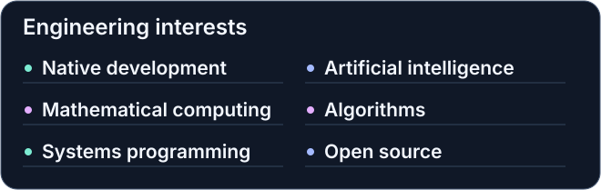

# Arnav Kulshreshtha

**Mathematics & Computing at BITS Pilani · Software Engineering · macOS · AI · Computational Science**

I study Mathematics and Computing at BITS Pilani, Goa. My work spans native macOS applications, systems programming, independent products, and open-source development. My interests include AI and machine learning, algorithms and problem solving in C++, computational science, and computational physics.

[LinkedIn](https://in.linkedin.com/in/arnav-kulshreshtha) · [Phosphor](https://usephosphor.app) · [Engineering work](#selected-engineering-work) · [Technical stack](#technical-stack) · [Open-source work](#open-source) · [Development analytics](#development-analytics) · [Competitive programming](#competitive-programming)

## Selected engineering work

### 01 · Phosphor

[Phosphor](https://usephosphor.app) brings display tools and presentation features together in a native Mac app. Flashbang Protection addresses abrupt brightness changes, and Studio Features support calls and presentations. Phosphor supports macOS 13 and later.

*Color Grading in Phosphor. Screenshot from the [official product site](https://usephosphor.app).*

**Stack** · Swift, SwiftUI, Metal, macOS

### 02 · Daemos

A native macOS file-organization system. Daemos monitors filesystem changes and uses local AI to help organize files on-device.

**Stack** · Swift, Objective-C++, C++, FSEvents, SQLite

### 03 · Warevote

A software discovery and ratings platform in development for apps, developer tools, and websites. Planned features include trusted user ratings, tools for discovering software, and community recognition for products.

**Stack** · TypeScript, React, Next.js, PostgreSQL · Website planned at `warevote.com`

### 04 · LPython

Compiler runtime patches address intermediate integer overflow in permutations, combinations, least common multiples, and hypotenuse calculations.

**Stack** · C++, compiler runtime · [Permutations and combinations](https://github.com/lcompilers/lpython/pull/2879) · [LCM and hypotenuse](https://github.com/lcompilers/lpython/pull/2881)

### 05 · MeghGen Technologies

During my software engineering internship, I contributed to developer tooling, including agent skills and cross-language test generation.

**Focus** · Developer automation, testing · [Shared tooling repository](https://github.com/sanskarkhatri-meghgen/skills)

## Development analytics

The language chart measures **filtered source bytes at the default-branch tip** across a curated project cohort that includes private work. It excludes upstream forks, tutorials, coursework, and known generated and vendored paths. The inventory counts owned repositories visible to the collection credential.

The GitHub calendar includes anonymized private activity when shared on the profile. Calendar contributions can include eligible commits, pull requests, reviews, issues, and other GitHub events. Restricted contributions are calendar entries whose underlying details GitHub withholds. The latest monthly bar is month-to-date through the date shown.

[Source and repository data](data/source.json) · [Contribution calendar data](data/calendar.json) · [Methods and coverage](ANALYTICS.md)

## Technical stack

## Currently exploring

- **Mathematics and computational physics** · numerical methods, modeling, and scientific computing.
- **AI and native software** · on-device processing and how it fits into desktop tools.
- **Algorithms and systems** · C++ problem solving, filesystem behavior, and compiler runtime correctness.

## Experience and education

**MeghGen Technologies · Software Engineering Intern**

May–July 2026 · Developer tooling, software automation, and testing.

**BITS Pilani · K. K. Birla Goa Campus**

B.E. (Hons.) in Mathematics and Computing · 2024–2028 (expected)

## Open source

| LPython contribution | Upstream submission |
| --- | --- |
| Permutations and combinations | [Intermediate overflow patch](https://github.com/lcompilers/lpython/pull/2879) |
| Least common multiple and hypotenuse | [Revised overflow patch](https://github.com/lcompilers/lpython/pull/2881) |
| Documentation | [Corrections and wording improvements](https://github.com/lcompilers/lpython/pull/2878) |

## Competitive programming

I primarily use **C++** for competitive programming, with a focus on algorithms and data structures. [Codeforces · aMartian](https://codeforces.com/profile/aMartian)

Problems solved counts distinct contest problems with an accepted submission in the Codeforces API. The chart shows rating changes from rated contests.
